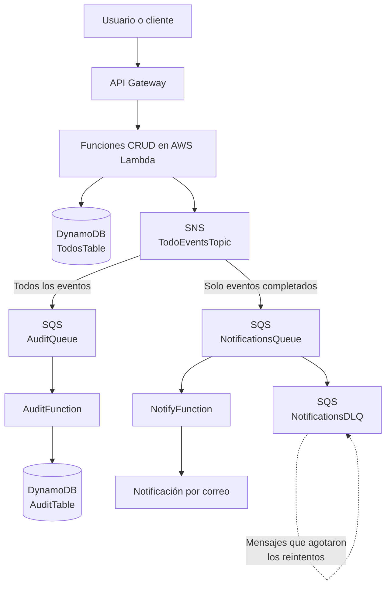

# Arquitectura y preguntas de repaso – Workshop Parte 2: SNS y SQS

## 1. Diagrama de arquitectura

El sistema utiliza Amazon SNS para distribuir los eventos generados por las operaciones del CRUD y Amazon SQS para almacenar los mensajes hasta que cada microservicio pueda procesarlos.

### Descripción del funcionamiento

1. El usuario realiza una operación mediante API Gateway.
2. API Gateway invoca la función Lambda correspondiente del CRUD.
3. La función realiza la operación en la tabla `TodosTable` de DynamoDB.
4. La función publica un evento en el tópico SNS `TodoEventsTopic`.
5. SNS distribuye el evento a las colas SQS suscritas.
6. `AuditFunction` consume los eventos de `AuditQueue` y guarda el historial en `AuditTable`.
7. `NotifyFunction` consume los eventos de `NotificationsQueue` y genera notificaciones cuando se cumplen las condiciones del filtro.
8. Si una notificación falla repetidamente, el mensaje puede terminar en `NotificationsDLQ` para su revisión y posterior redrive.

---

## 2. Preguntas de repaso

### 1. ¿Qué diferencia hay entre SNS y SQS? ¿Por qué en este workshop los usamos juntos?

Amazon SNS es un servicio de publicación y suscripción (*publish/subscribe*). Su función es distribuir un mensaje a diferentes suscriptores cuando se publica un evento.

Amazon SQS es un servicio de colas de mensajes. Su función es almacenar los mensajes hasta que un consumidor los procese.

En este workshop se utilizan juntos porque SNS permite distribuir un mismo evento a varios microservicios, mientras que SQS permite que cada microservicio procese los mensajes de manera independiente, sin necesidad de hacerlo inmediatamente.

Por ejemplo, cuando se completa una tarea, SNS distribuye el evento a la cola de auditoría y a la cola de notificaciones. Cada función Lambda procesa su mensaje de forma independiente.

### 2. Si mañana se agrega un microservicio de estadísticas, ¿qué archivos del CRUD hay que modificar? ¿Por qué?

En principio, no sería necesario modificar los archivos del CRUD si estos ya publican los eventos necesarios en SNS.

Se podría agregar una nueva función Lambda, por ejemplo `stats_consumer.py`, junto con una nueva cola SQS y su suscripción al tópico SNS. También habría que actualizar `template.yaml` para declarar los nuevos recursos, permisos y conexiones.

Esto es posible porque la arquitectura está desacoplada: el CRUD publica eventos y los microservicios consumidores reaccionan a ellos sin depender directamente unos de otros.

Solamente habría que modificar las funciones del CRUD si el nuevo microservicio necesita un evento o información que actualmente no se está publicando.

### 3. Un lote trae 10 mensajes y falla 1. ¿Qué pasa si el handler devuelve batchItemFailures? ¿Y si lanza una excepción?

Si la función Lambda utiliza el mecanismo de respuesta parcial de lotes (*partial batch response*) y devuelve `batchItemFailures`, puede indicar cuáles mensajes fallaron.

En este caso, si falló un solo mensaje, Lambda puede volver a intentar únicamente ese mensaje, mientras los otros nueve se consideran procesados correctamente.

En cambio, si el handler lanza una excepción sin utilizar correctamente ese mecanismo, el lote completo se considera fallido y los mensajes pueden volver a entregarse, incluso aquellos que ya se habían procesado correctamente.

Por eso, `batchItemFailures` permite evitar reprocesamientos innecesarios y mejora la eficiencia del consumidor.

### 4. ¿Por qué la SK de AuditTable incluye el eventId? ¿Qué problema evita?

La clave de ordenamiento (*Sort Key* o SK) de `AuditTable` incluye el `eventId` para identificar de manera única cada evento dentro de un mismo registro o partición.

Esto evita que dos eventos generados en momentos muy cercanos, o incluso con la misma marca de tiempo, tengan la misma clave y uno sobrescriba al otro.

Además, facilita almacenar y consultar el historial de eventos de una tarea sin perder registros.

### 5. ¿Por qué el VisibilityTimeout de la cola debe ser mayor que el Timeout de la Lambda?

El `VisibilityTimeout` determina cuánto tiempo un mensaje permanece oculto para otros consumidores después de ser recibido por una función Lambda.

Debe ser mayor que el tiempo máximo de ejecución de la Lambda para darle tiempo suficiente de procesar el mensaje y confirmar su recepción.

Si el tiempo de visibilidad es menor, el mensaje podría volver a estar disponible antes de que termine la ejecución de Lambda. Esto puede provocar que otro consumidor reciba y procese el mismo mensaje simultáneamente.

Por eso, se recomienda configurar el `VisibilityTimeout` por encima del `Timeout` de la función Lambda.

### 6. El mensaje #fail lo procesó bien AuditFunction pero no NotifyFunction. ¿Qué propiedad de la arquitectura demuestra eso?

Demuestra el desacoplamiento entre los consumidores y el uso de filtros de suscripción de SNS.

El evento se publica una sola vez en SNS, pero cada suscripción puede tener una política de filtrado diferente.

En este caso, `AuditFunction` recibe los eventos para registrar el historial, mientras que `NotifyFunction` recibe solamente los eventos que cumplen su filtro.

Por lo tanto, el fallo de la notificación no impide que la auditoría procese correctamente el evento. Cada consumidor tiene su propia cola y gestiona sus errores y reintentos de manera independiente.

### 7. ¿Qué riesgo tiene publicar en SNS después de escribir en DynamoDB, y cómo lo mitigarías?

Existe un riesgo de inconsistencia entre DynamoDB y SNS.

Por ejemplo, la operación puede guardarse correctamente en DynamoDB, pero la publicación del evento en SNS puede fallar. En ese caso, la tarea queda registrada, pero los microservicios consumidores no reciben el evento y no ejecutan sus procesos.

Una forma de mitigar este problema es implementar el patrón **Transactional Outbox**.

Este patrón consiste en guardar la operación y el evento pendiente de publicación en una misma transacción de base de datos. Después, un proceso independiente lee los eventos pendientes y los publica en SNS. Cuando la publicación se completa, el evento se marca como procesado.

También es importante implementar consumidores idempotentes, para evitar que un mismo evento genere efectos duplicados cuando se recibe más de una vez.

---

## 3. Conclusión

La integración de SNS y SQS permite construir una arquitectura basada en eventos, donde los microservicios trabajan de forma independiente. Esto facilita agregar nuevos consumidores, manejar errores, realizar reintentos y mantener el historial de las operaciones sin acoplar directamente los componentes del sistema.
